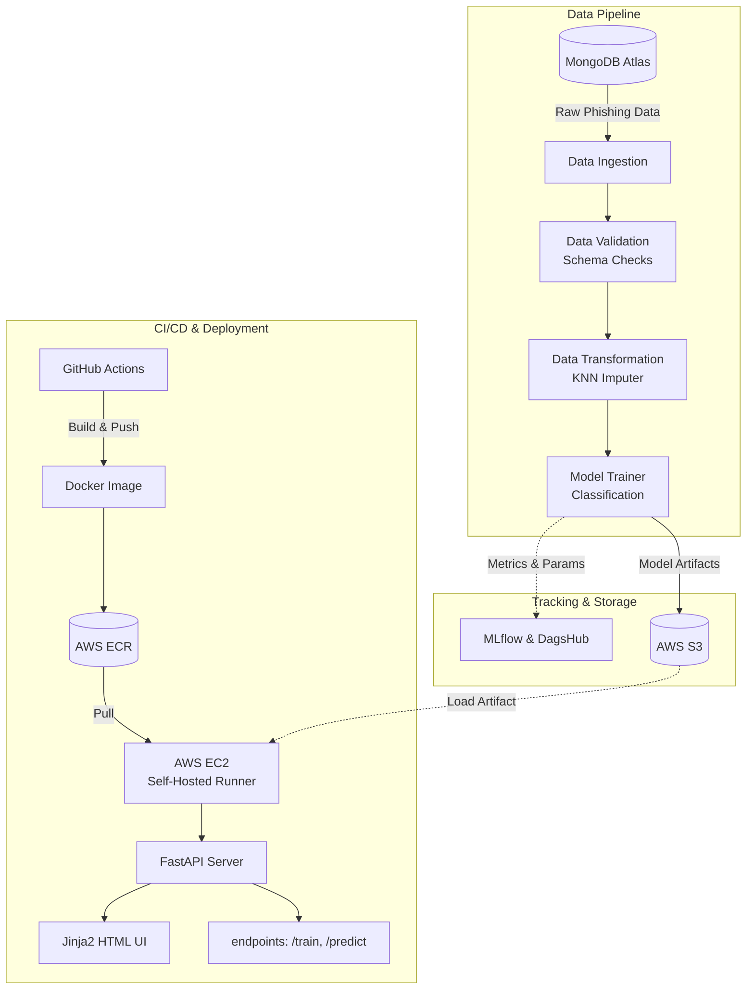

# 🛡️ End-to-End Network Security MLOps Pipeline


## 📌 Overview
This repository contains a fully automated, containerized MLOps pipeline designed to detect network security threats (phishing). It handles the complete machine learning lifecycle: extracting raw data from MongoDB Atlas, validating schemas, training a classification model, and deploying it as a REST API. The system features continuous integration and continuous deployment (CI/CD) using GitHub Actions and AWS.

## 🏗️ System Architecture & Data Flow

This system implements a robust experiment tracking workflow via MLflow and DagsHub alongside a container registry workflow utilizing AWS ECR and a self-hosted EC2 runner.



### Data Flow Breakdown
* **Ingestion & Validation:** Raw phishing data is extracted from a remote MongoDB Atlas cluster, followed by automated schema validation to ensure data integrity.
* **Transformation & Training:** Validated datasets pass through a KNN Imputer to handle missing values, and the processed data is fed into a classification model trainer.
* **Experiment Tracking:** Throughout training, all hyperparameters, metrics, and configurations are logged remotely to DagsHub via the MLflow integration.
* **Artifact Storage:** Final trained model objects and preprocessor pipelines are serialized and pushed to an AWS S3 bucket for durable storage.
* **Continuous Deployment:** GitHub Actions triggers a Docker build, pushes the image to AWS ECR, and orchestrates an AWS EC2 self-hosted runner to pull the latest image.
* **Serving:** A FastAPI server runs inside the EC2 container, pulling the latest artifacts from S3, and exposing API endpoints while rendering a Jinja2 frontend template.

## 💻 Tech Stack
* **Language:** Python
* **Data Storage:** MongoDB Atlas, AWS S3
* **Machine Learning:** Scikit-learn, KNN Imputer
* **MLOps & Tracking:** MLflow, DagsHub, DVC
* **API & Frontend:** FastAPI, Jinja2, HTML/CSS
* **DevOps & Deployment:** Docker, AWS ECR, AWS EC2, GitHub Actions

## 🚀 Getting Started

### Prerequisites
* Python 3.8+
* Docker installed
* AWS CLI configured with appropriate IAM permissions
* MongoDB Atlas connection string

### Installation

1. **Clone the repository:**
   ```bash
   git clone https://github.com/Oshobugie/networksecurity.git
   cd networksecurity
   ```

2. **Set up the environment:**
   Create a `.env` file in the root directory and add your credentials:
   ```ini
   MONGO_DB_URL="your_mongodb_connection_string"
   AWS_ACCESS_KEY_ID="your_aws_access_key"
   AWS_SECRET_ACCESS_KEY="your_aws_secret_key"
   MLFLOW_TRACKING_URI="your_dagshub_uri"
   ```

3. **Install dependencies:**
   ```bash
   pip install -r requirements.txt
   ```

4. **Run the application locally:**
   ```bash
   uvicorn app:app --host 0.0.0.0 --port 8000 --reload
   ```

## 🔌 API Usage
Once the FastAPI server is running (default `http://localhost:8000`), you can access the following endpoints:

* **UI Interface:** Navigate to `/` in your browser to access the Jinja2 HTML rendering.
* **`/train` (GET):** Triggers the data ingestion, training pipeline, and artifact saving process.
* **`/predict` (POST):** Accepts a payload of network features and returns a phishing classification prediction.
* **`/docs`:** Interactive Swagger UI for testing endpoints.

## 👨‍💻 Author
**Osho**  
Machine Learning & AI Automation Engineer  
[LinkedIn](https://www.linkedin.com/in/oshobugie) | [GitHub](https://github.com/Oshobugie)
